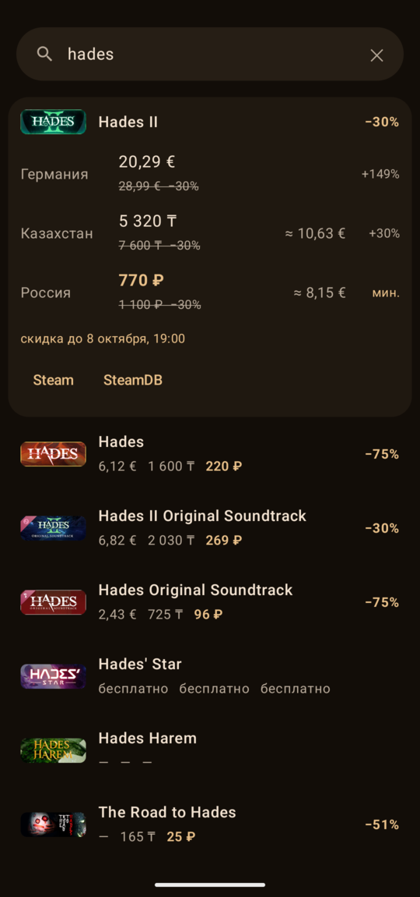

# Steam цены

Android-приложение и виджет для рабочего стола, которые показывают **реальные региональные цены Steam** сразу в трёх регионах — 🇩🇪 Германия (€), 🇰🇿 Казахстан (₸) и 🇷🇺 Россия (₽) — и сравнивают их в одной валюте.

Steam задаёт цены по регионам отдельно, поэтому простой перевод евро в тенге по курсу ничего не говорит о том, где игра дешевле. Здесь берутся настоящие цены из каждого региона, а пересчёт по курсу ЦБ нужен только для сравнения.

<p align="center"></p>

## Возможности

- **Поиск игры** — цены во всех регионах, скидки, зачёркнутая старая цена и дата окончания скидки.
- **Сравнение** — «≈» цена в основной валюте, самый выгодный регион подсвечен, у остальных видно «+N%».
- **Основная валюта** на выбор: €, ₸ или ₽.
- **Недавние** — открытые игры сами попадают в список, ничего добавлять вручную не нужно.
- **Вишлисты нескольких аккаунтов** — объединяются в один список с пометкой, в каком аккаунте игра. Сортировка (по скидке, по цене, по дате, по названию) и фильтры (только со скидкой, только один аккаунт).
- **Виджет** — строка поиска и недавние или вишлист; обновляется в фоне раз в 3 часа.
- Цвета Material You под обои, светлая и тёмная тема.

## Откуда данные

Вход в Steam и API-ключи не нужны.

| Что | Откуда |
| --- | --- |
| Поиск | `store.steampowered.com/api/storesearch` |
| Цены, названия, скидки | `api.steampowered.com/IStoreBrowseService/GetItems` с `country_code` DE / KZ / RU |
| Вишлист | `api.steampowered.com/IWishlistService/GetWishlist` |
| Профиль по ссылке | `steamcommunity.com/id/<name>/?xml=1` |
| Курсы валют | [cbr-xml-daily.ru](https://www.cbr-xml-daily.ru/) (курсы ЦБ РФ) |

Вишлист виден только если в Steam открыт доступ к игровой информации:
*Профиль → Редактировать профиль → Приватность → «Доступ к игровой информации: Открытый»*.

## Приватность

Приложение не собирает и никуда не отправляет данные, кроме запросов к сервисам из таблицы выше. Добавленные аккаунты (публичный SteamID и ник), недавние игры и кэш цен хранятся только на телефоне.

## Сборка

Нужен Linux x86_64, `curl`, `unzip` и телефон с Android 12+ с включённой отладкой по USB.

```sh
./setup.sh   # один раз: JDK 21 и Android SDK скачиваются в .tools/, в систему ничего не ставится
./build.sh   # собрать debug-APK и установить на подключённый телефон
```

Если JDK 17+ и Android SDK уже есть, достаточно `ANDROID_HOME` и `./gradlew assembleDebug`.

Виджет: долгое нажатие на рабочем столе → «Виджеты» → «Steam цены».

## Устройство

```
app/src/main/java/dev/steamprice/
├── Steam.kt         запросы к Steam и ЦБ, разбор ответов
├── Repo.kt          общее состояние (StateFlow) для приложения и виджета, хранение, фоновое обновление
├── MainActivity.kt  интерфейс приложения (Jetpack Compose)
└── PriceWidget.kt   виджет (Jetpack Glance)
```

Kotlin, Jetpack Compose + Material 3, Glance для виджета, WorkManager для фонового обновления. Сторонних зависимостей, кроме AndroidX, нет.

---

Неофициальный проект, не связан с Valve. Steam — торговая марка Valve Corporation.

Лицензия — [MIT](LICENSE).
